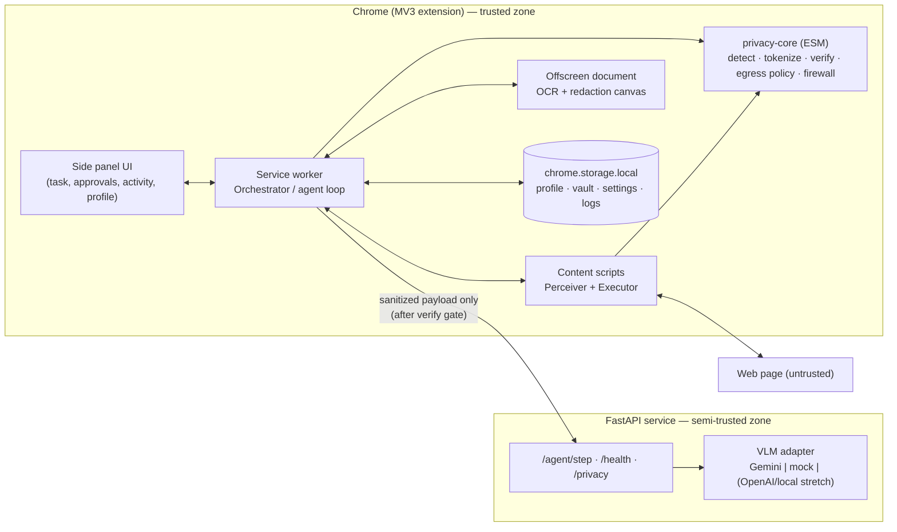

# 04 — Architecture

> **Derived architecture.** The deck's architecture diagram (slide 5) could not be read. This design is derived from slides 2, 3, 4 and 6 and the user's decisions. Compare with your slide 5 and tell me what differs (Q2).

## 1. Principles

1. **Local first.** Perception, detection, redaction, tokenization, verification and execution happen in the browser.
2. **One egress door.** Everything that leaves the machine passes one function (`enforceEgress`) built on the security policy module (doc 03). No other code may call `fetch` to the server.
3. **Fail closed.** Unknown, error or timeout in the privacy path means "do not send".
4. **Least privilege.** Actions are deny-by-default unless classified safe; the model proposes, the firewall disposes, the user approves.
5. **Model is untrusted.** The VLM output is treated like user input from the internet: validated against a schema and against the known page nodes.
6. **Page is untrusted.** Page text can be a prompt injection; it is scanned by the adversarial guard and passed to the model as data, not instructions.

## 2. Components



| Component | Responsibility | Runs in |
|---|---|---|
| Side panel UI | Enter task; show live activity; approve/deny actions; edit profile; settings. | Extension page |
| Orchestrator | Agent loop, planner state, step sequencing, retries, stop/abort. | Service worker |
| Perceiver | Build the **skeleton** from DOM + accessibility; classify fields; gather text; request screenshot. | Content script |
| Executor | Perform validated actions on the page (type, click, select, scroll, submit, navigate, search, extract). Resolve tokens to real values at the last moment. | Content script |
| Vision/OCR | OCR the screenshot, draw redaction boxes, re-OCR the masked image (recheck). | Offscreen document |
| privacy-core | Pure functions: `detectPII`, `scanSecrets`, `Vault`, `verifyRedaction`, `classifyPayload`, `classifyAction`, `detectPromptInjection`, `urlRisk`. | Imported by SW / CS / offscreen |
| Server | Validate request schema, build prompt, call VLM, validate response, return actions. Holds API keys. Stateless. | Python process |
| Storage | Profile, vault (token → value), settings, activity log. | `chrome.storage.local` **[DECK S4]** |

## 3. The step loop (per step)

Pipeline order, extended for planning.

| # | Step | Where | Fail behaviour |
|---|---|---|---|
| 1 | Build skeleton (DOM + a11y), page text, URL | CS | Retry once, else stop with error. |
| 2 | Adversarial scan of page text/hidden styles | CS | Mark page `MALICIOUS`/`SUSPICIOUS`; raises firewall risk. |
| 3 | Screenshot visible tab | SW | Retry; else continue DOM-only **only if** policy allows (setting; default: stop). |
| 4 | Detect PII in DOM text, field values and OCR text; merge boxes | CS + OFF | If OCR fails: DOM-only mode flagged in the activity log. |
| 5 | Update **vault** with profile values + detected values → tokens | SW | — |
| 6 | Redact screenshot (black boxes) | OFF | If canvas fails → stop. |
| 7 | **Verify gate**: re-OCR masked image, re-detect; one extra mask pass; still leaking → `REDACTION_FAILED` | OFF | **Block egress.** |
| 8 | Sanitize skeleton and goal: replace known values with tokens; drop raw values from fields | SW | Block egress on error. |
| 9 | **Egress policy** over the exact outgoing bytes: canary, secrets, restricted PII, unknown PII | SW | `BLOCK` → stop; `SANITIZE` → apply sanitized copy and re-check; `REQUIRE_APPROVAL` → ask user. |
| 10 | Optional "show me what will be sent" approval | UI | User can cancel. |
| 11 | POST to `/agent/step` | SW → API | 503 → stop, offer retry. **No silent mock fallback.** |
| 12 | Validate response: schema, targets exist in skeleton, tokens exist in vault, no unknown action | SW | Reject and report. |
| 13 | **Action Firewall** per action | SW | `BLOCK` → refuse; `REQUIRE_APPROVAL` → ask; `ALLOW` → proceed. |
| 14 | Execute (resolve tokens to values locally) | CS | Record result. |
| 15 | Stagnation / repeat-plan guard | SW | Stop after N repeated no-op steps. |
| 16 | Log to activity feed; loop to 1 until `done` or limit | UI | Hard step cap and wall-clock cap. |

## 4. Beyond forms: planner and task state **[USER]**

A form-only agent needs no explicit plan. Mikoshi adds:

- **Task** = goal text (sanitized) + `mode` (`act` or `read_only`) + step budget.
- **Plan (optional, MVP-lite)**: the model returns, with each step, a short `rationale` and `done`. A separate planning call is **Stretch**; MVP uses the iterative "observe → act" loop that already generalises to multi-page tasks.
  **[ASSUMPTION]** Reason: 48 hours; one loop is simpler and testable.
- **Cross-page memory**: the orchestrator keeps `history` (action + result summary, tokens only) and `extracted` (named results). It survives page navigation because it lives in the service worker, not the page.
- **New actions**: `navigate(url)`, `open_tab(url)`, `search(query)`, `extract(name, targetIds)`, `ask_user(question)`. All run through the firewall; `navigate`/`open_tab` also through `urlRisk`.
- **Extraction output**: extracted text is re-scanned and tokenized before it is stored in `history`, and is shown to the user with real values re-inserted locally.

## 5. Sequence diagram — KYC form fill (demo A)

```mermaid
sequenceDiagram
  actor U as User
  participant UI as Side panel
  participant SW as Orchestrator (SW)
  participant CS as Page scripts
  participant OFF as Offscreen (OCR)
  participant PC as privacy-core
  participant API as FastAPI
  participant M as VLM (Gemini/mock)
  U->>UI: "Fill my KYC form" (profile has Aadhaar, PAN)
  UI->>SW: start task
  SW->>CS: get skeleton + text
  CS-->>SW: skeleton (fields labelled, values empty)
  SW->>OFF: screenshot -> OCR + boxes
  OFF-->>SW: boxes + redacted image
  SW->>PC: vault.addProfile(profile) -> [AADHAAR_1],[PAN_1]
  SW->>OFF: verifyRedaction(masked image)
  OFF-->>SW: ok (or REDACTION_FAILED -> stop)
  SW->>PC: sanitize skeleton + goal; classifyPayload(bytes)
  PC-->>SW: ALLOW / SANITIZE ok
  SW->>API: POST /agent/step (tokens only)
  API->>M: prompt + redacted screenshot
  M-->>API: actions [type #aadhaar fillToken=[AADHAAR_1] ...]
  API-->>SW: validated actions
  SW->>PC: classifyAction (restricted PII into same-origin field -> MEDIUM/ALLOW or approval per policy)
  SW->>UI: show action (approval if required)
  U-->>UI: Approve
  SW->>CS: execute: resolve [AADHAAR_1] locally, type into field
  CS-->>SW: result
  SW->>UI: activity log entry (tokens shown, values masked)
```

## 6. Sequence diagram — non-form task (demo B) **[ASSUMPTION: task choice]**

Goal: "Find the fee due date and amount for my program on the portal and tell me." Read-only mode.

1. Step 1: page is the portal home. Model proposes `click` on "Fees" menu → firewall `ALLOW` (same-origin link, non-mutating).
2. Step 2: fees page with table. Model proposes `extract(name="fee_table", targetIds=[...])` → `ALLOW`.
3. Step 3: model returns `done` with a summary using the extracted text.
4. Orchestrator re-inserts any tokens locally and shows the summary in the side panel.
5. A planted trap link ("Pay now") would be `REQUIRE_APPROVAL`/`BLOCK` per `PAYMENT_RE`.

## 7. Trust boundaries

| Boundary | Crosses | Control |
|---|---|---|
| Page → extension | untrusted DOM/text/images | adversarial guard; treat as data; never execute page-provided instructions |
| Extension → server | sanitized skeleton, redacted image, tokenized goal, history | verify gate + egress policy + canaries |
| Server → VLM provider | same sanitized data | server must not log payloads; no extra enrichment |
| VLM → extension | proposed actions | schema validation + target check + firewall + user approval |
| Extension → storage | profile, vault | local only; encryption at rest is **Stretch** (Q8) |

## 8. Failure modes

| Failure | Behaviour |
|---|---|
| Server down or 503 | Stop, show error, offer retry. No fallback model. |
| Gemini returns invalid JSON | Server returns 502/validation error; client stops. |
| OCR worker fails | Stop (default) or DOM-only if setting enabled. |
| Verify gate fails | Stop; log `REDACTION_FAILED`; nothing sent. |
| Firewall `BLOCK` | Skip action, tell the model it was blocked, stop after repeated blocks. |
| User denies approval | Stop or let the model re-plan once. |
| Page navigates mid-step | Orchestrator re-perceives; step counted. |
| Token not in vault | Reject action (model hallucinated a token). |
